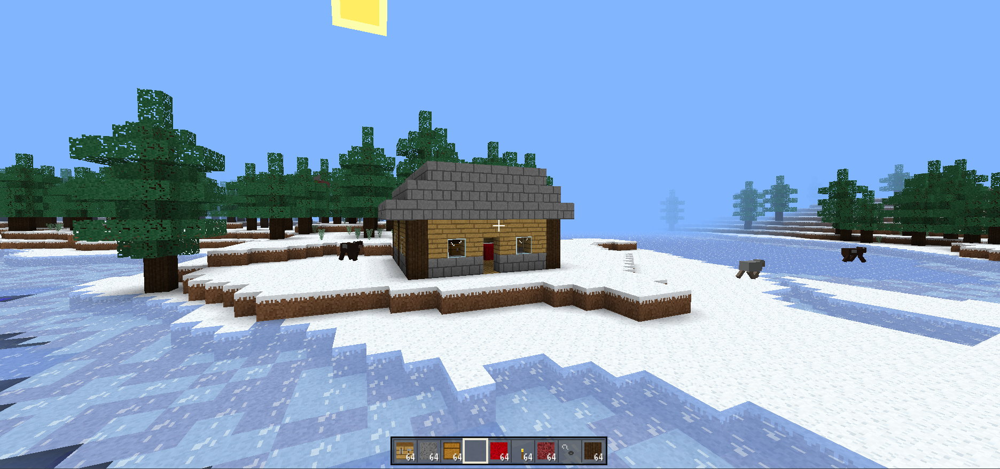

# AIMinecraft

$${ \Huge \color{cyan} \textsf{This was all generated by AI!} }$$

Yes, this is a clone of minecraft entirely generated by a large language model ai, model opus 5.5

This game aparently features:
- Survival
- Creative
- Mobs
- Daylight cycle
- Crafting and smelting
- Saving
- The nether
- The aether

and you can try this abomination [here](https://aiminecraft.pages.dev/index.html)

-----
###### Disclaimer: I DID NOT MADE THIS GAME, THIS WAS ENTIRELY BUILT BY AI AND I DO NOT HAVE ANY FINGERPRINT IN THIS $#!7, SO PLEASE DO NOT HARASS ME FOR CLAIMING THIS WAS MADE BY ME, BECAUSE IT WAS NOT AND PLEASE SHUT UP!!!
